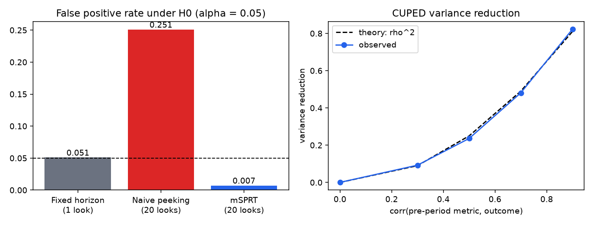

# abkit: A/B testing statistics, checked by simulation

A small Python library for analysing online controlled experiments. **Every method ships with a Monte Carlo study that checks whether it actually delivers the error rate it promises.** Most A/B testing write-ups state the formulas. This one measures them.

| Method | What it's for | Verified property |
|---|---|---|
| Power / sample size | Plan how long a test must run | Empirical power at the computed n ≈ 80% |
| Welch t-test, two-proportion z-test | Fixed-horizon analysis | Matches `scipy` exactly; ~5% false positives |
| **CUPED** (Deng et al., 2013) | Cut variance with a pre-period covariate | Variance reduction ≈ ρ², unbiased, CI coverage ≈ 95% |
| **Delta method** for ratio metrics | CTR, revenue/session, where the user is the randomization unit | Coverage ≈ 95%, while the naive session-level SE under-covers |
| **mSPRT always-valid p-values** (Johari et al., 2017) | Monitor a test continuously without inflating false positives | FPR ≤ α with 20 looks, while naive peeking gives ~25% |
| **Sample ratio mismatch** check | Catch broken assignment or logging | False alarm rate ≈ the 0.001 threshold |

## Results (seed 7, `python -m abkit.study`)



**Peeking.** 10,000 null experiments, each checked 20 times.

| Rule | False positive rate (target 0.05) | Power at effect = 0.05 sd |
|---|---|---|
| Fixed horizon, one look | 0.051 | 0.703 |
| Naive peeking, stop at first p < 0.05 | **0.251** | 0.829* |
| mSPRT always-valid p-value | 0.007 | 0.377 |

\*Naive peeking's "power" is meaningless: it comes bundled with a 25% false positive rate.

The honest trade-off: mSPRT buys the right to stop at any time by being conservative at a fixed sample size. With the mixing variance τ² = (0.05 sd)², it rejected in 38% of runs where the fixed test reached 70%. When it did reject, it stopped after 3,320 of 5,000 users per arm on average. The choice of τ² is a tuning decision you should match to the effects you actually expect.

**CUPED.** Variance reduction tracks the theoretical ρ² (0.09 / 0.24 / 0.48 / 0.82 at ρ = 0.3 / 0.5 / 0.7 / 0.9), with bias under 0.002 and 95% CI coverage between 0.945 and 0.954.

**Ratio metrics.** With per-user click propensities, treating sessions as independent gives 95% intervals that cover only **88.4%** of the time. The delta method, with the user as the unit, gives 94.0%.

**Power and SRM.** The calculator's 1,570 users per arm (MDE 0.1 sd) gave an empirical power of 0.796. The SRM check raised false alarms 0.11% of the time on correct splits, and caught a 49.5/50.5 assignment bug at 100k users 46% of the time.

The full tables are in [`results/report.md`](results/report.md), and the raw numbers in [`results/results.json`](results/results.json).

## Usage

```python
from abkit import welch_ttest, cuped_adjust, ratio_metric_test, msprt_always_valid_pvalues, srm_check, sample_size_means

n = sample_size_means(sigma=12.0, mde=0.5)          # users per arm
p, mismatch = srm_check([50_310, 49_690], [1, 1])  # run first: a mismatch voids the test
yc, yt, theta = cuped_adjust(y_c, pre_c, y_t, pre_t)
result = welch_ttest(yc, yt)                       # effect, std_error, p_value, ci_low, ci_high
```

## Run it

```bash
uv venv && uv pip install -e '.[dev]'
pytest                       # unit tests, including a type-I-error check of mSPRT
python -m abkit.study        # regenerates results/ (~30 s on a laptop)
```

## Design notes

- The SRM threshold is 0.001, not 0.05. SRM checks run on every experiment, and a real mismatch almost always means a bug, not bad luck.
- CUPED's θ is estimated on both arms pooled. The covariate is pre-randomization, so the adjustment cannot leak the treatment effect.
- The ratio-metric variance uses `Var(X̄ − R·Ȳ) / Ȳ²` on per-user sums, so the analysis unit matches the randomization unit.
- The peeking simulation draws per-look batch sums directly (sufficient statistics), which keeps 10,000 × 20 looks fast without changing the distribution.

## References

- Deng, Xu, Kohavi, Walker (2013). *Improving the Sensitivity of Online Controlled Experiments by Utilizing Pre-Experiment Data.*
- Johari, Pekelis, Walsh (2017). *Always Valid Inference: Bringing Sequential Analysis to A/B Testing.*
- Kohavi, Tang, Xu (2020). *Trustworthy Online Controlled Experiments.*
