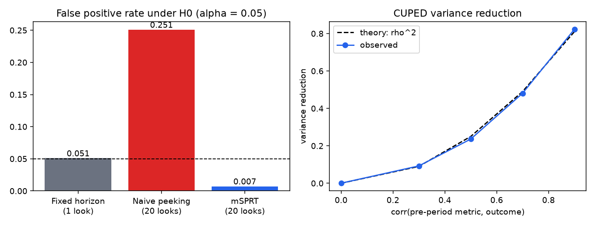

# Simulation study results

Seed 7. Every number below is produced by `python -m abkit.study`; rerun to reproduce.

## 1. Peeking: fixed horizon vs naive repeated testing vs mSPRT

10000 simulated experiments, 5000 users per arm, 20 interim looks.

| Rule | Reject rate, no true effect | Reject rate, effect = 0.05 sd |
|---|---|---|
| Fixed horizon (analyse once at the end) | 0.051 | 0.703 |
| Naive peeking (stop at first p < 0.05) | **0.251** | 0.829 |
| mSPRT always-valid p-value | 0.007 | 0.377 |

When mSPRT rejects under the true effect it does so after 3320 users per arm on average (of 5000).

## 2. CUPED

| corr | variance reduction (observed) | theory (rho^2) | bias | 95% CI coverage |
|---|---|---|---|---|
| 0.0 | 0.000 | 0.000 | +0.0018 | 0.948 |
| 0.3 | 0.093 | 0.090 | -0.0009 | 0.945 |
| 0.5 | 0.236 | 0.250 | +0.0003 | 0.953 |
| 0.7 | 0.481 | 0.490 | -0.0006 | 0.950 |
| 0.9 | 0.823 | 0.810 | +0.0001 | 0.954 |

## 3. Ratio metrics (CTR = clicks / sessions), no true effect

| Standard error | 95% CI coverage |
|---|---|
| Delta method, user as the unit | 0.940 |
| Naive, sessions treated as independent | **0.884** |

## 4. Power calculator

Sample size for MDE = 0.1 sd at 80% power: 1570 per arm. Empirical power at that size: 0.796.

## 5. Sample ratio mismatch check (p < 0.001)

False alarm rate with a correct 50/50 split: 0.0011. Detection rate for a 49.5/50.5 split at 100k users: 0.456.

